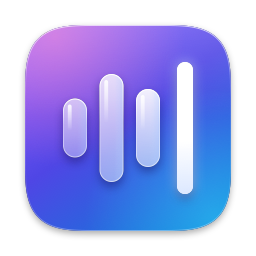
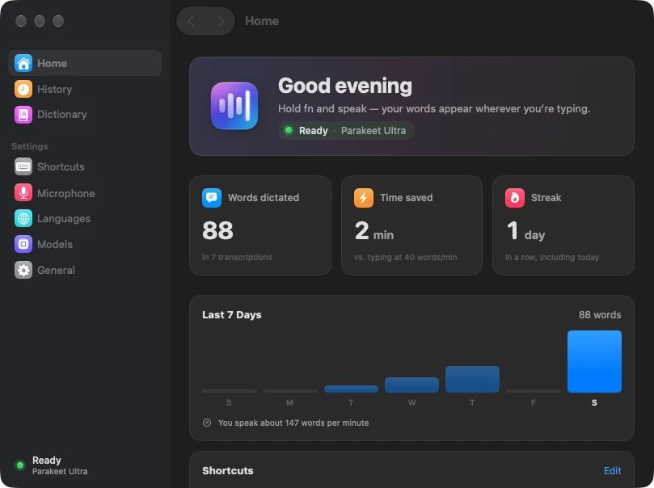
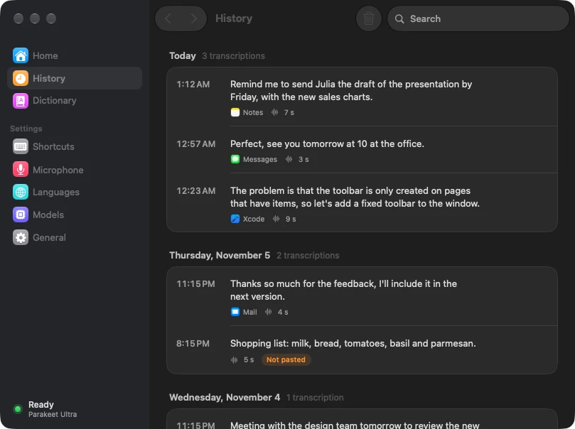
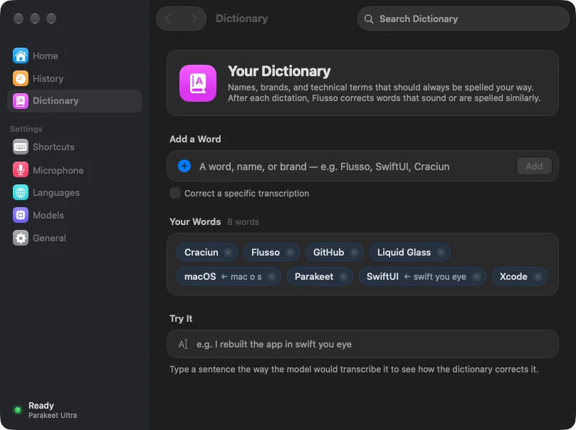
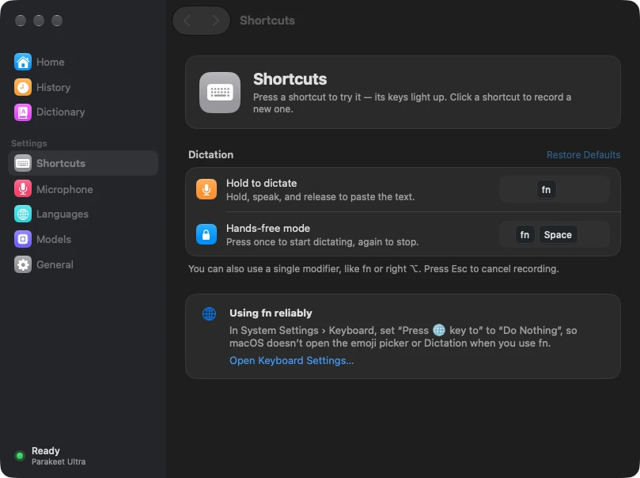
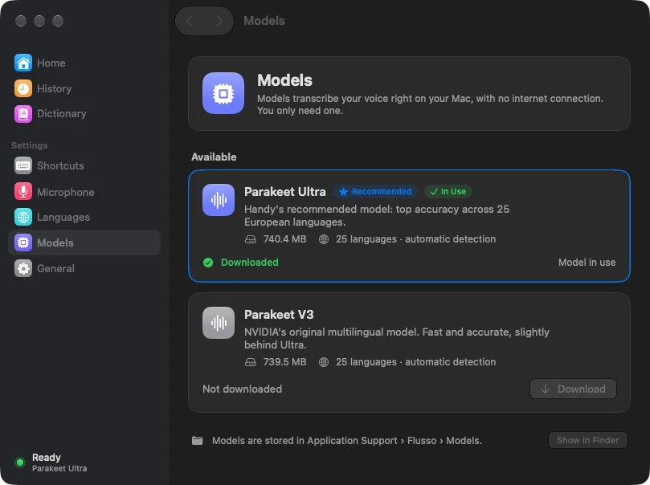

<p align="center">
  <a href="https://github.com/IGOLz/flusso/releases/latest"></a>
  
  
  <a href="LICENSE"></a>
</p>

<p align="center">
  
</p>
<h1 align="center">Flusso</h1>
<h3 align="center">Free, fully local voice dictation for the Mac: hold a key, speak, and the text appears where you type</h3>
<br/>

<p align="center">
  
</p>

<p align="center">
  <a href="https://github.com/IGOLz/flusso/releases/latest"><b>Download</b></a> ·
  <a href="#features">Features</a> ·
  <a href="#screenshots">Screenshots</a> ·
  <a href="#build-from-source">Build</a> ·
  <a href="#contributing">Contributing</a>
</p>

> [!NOTE]
> Flusso is an independent open-source project, inspired by [Wispr Flow](https://wisprflow.ai) and **not affiliated with it**. It runs on the transcription engine of [Handy](https://github.com/cjpais/handy).

## Why

Cloud dictation apps send every word you say to a server and charge a monthly fee. Flusso transcribes on your Mac, with the open Parakeet models: nothing you say leaves the computer, it works offline, and it's free. It lives in the menu bar and pastes straight into the app you're using.

## Install

1. Download **Flusso-x.y.z.dmg** from the [latest release](https://github.com/IGOLz/flusso/releases/latest).
2. Open it and drag **Flusso** to Applications.
3. Open Flusso and follow the setup: grant **Microphone** and **Accessibility** access, then download a model (about 740 MB).

The app is signed with a Developer ID and notarized by Apple, so it opens without Gatekeeper warnings. It updates itself: it looks for a new version at launch and once a day, and asks before installing it. Choose **Check for Updates…** in the menu bar, or turn on automatic installs in **General › Updates**.

**Requirements:** macOS 14 Sonoma or later. Flusso is a universal app: on Apple silicon it transcribes on the GPU with Metal, on Intel Macs on the CPU.

On macOS 14 and 15 everything works the same; the interface uses standard translucent materials instead of Liquid Glass, which needs macOS 26.

> [!TIP]
> In **System Settings › Keyboard**, set *Press 🌐 key to* to *Do Nothing*, otherwise `fn` also opens the emoji picker.

## Features

- **Hold to dictate**: hold `fn`, speak, release to transcribe and paste.
- **Hands-free mode**: `fn` + `Space` locks recording. Press `fn` + `Space` again, tap `fn` or click ✓ to finish; `Esc` or × cancels.
- **Pastes where you type**: the text goes into the focused field of the frontmost app. If no text field is focused, a small panel offers a **Copy** button.
- **Dictionary**: add names, brands and technical terms. After each dictation, words that sound or are spelled similarly are corrected (the same algorithm as Handy). You can also map how the model writes a word to a fixed replacement, for example "igol dot dev" → "igol.dev".
- **Instant start** (optional, Microphone settings): the microphone stays ready, so recording starts in under 1 ms and includes the 300 ms *before* you press the key.
- **Parakeet Ultra** (Handy's recommended model): 25 European languages with automatic detection. It runs locally on the GPU; a few seconds of speech are transcribed in about 40 ms.
- **Several languages**: speak any of the languages you selected and switch freely between them.
- **Snippets**: say a short phrase ("my calendly link") and Flusso inserts a longer text instead: a link, an address, a signature.
- **Learns from your corrections**: fix a misheard name right after dictating it and Flusso offers to add it to the dictionary.
- **Smart formatting** (macOS 26, Apple Intelligence): "at 5, no wait, at 6" becomes "at 6", and spoken numbered lists become real lists. It runs on device, only when you correct yourself or number a list, and keeps your original text if the edit would change your words.
- **Styles by app**: formal in Mail, casual or very casual (no capitals) in Messages. Only capitals and punctuation change.
- **Skip silence**: the bundled [Silero VAD](https://github.com/snakers4/silero-vad) transcribes only the parts where you speak, so a dictation with no speech inserts nothing.
- **History with audio**: replay a dictation or transcribe it again with another model. **Paste last transcription** (`⌃⌘V`) pastes your latest dictation again.
- **Insert by pasting or typing** (for apps that block pasting), with an optional space after the text.
- Lifetime statistics (words, time saved, streak), filler-word removal, microphone choice, sounds and launch at login.

All shortcuts can be changed in **Shortcuts**.

## Screenshots

<p align="center">
  
  
</p>
<p align="center">
  
  
</p>

## Privacy

Your voice never leaves the Mac: recording and transcription happen entirely on device, and there is no analytics, no tracking and no account. Flusso connects to the internet only to:

- **Download a model** from [Hugging Face](https://huggingface.co/handy-computer), when you choose one. The file is checked against its SHA-256 checksum.
- **Check for updates** on GitHub (`github.com/IGOLz/flusso/releases`), at launch and once a day unless you turn it off.

Your history (the last 100 transcriptions, with their recordings unless you turn that off), statistics and models are stored in `~/Library/Application Support/Flusso`; settings, the dictionary and snippets in the app's preferences. Smart formatting uses Apple Intelligence's on-device model, never Private Cloud Compute. To learn from your corrections, Flusso reads the text field you dictated into for one minute after each dictation, through Accessibility; nothing it reads is stored unless you add a word.

## Build from source

You need Xcode 26 or later. The app builds with the macOS 26 SDK and runs on macOS 14 or later; APIs newer than macOS 14 are wrapped in `#available` checks in `App/Sources/UI/Compat.swift`.

```sh
brew install xcodegen cmake ninja
git clone --recursive https://github.com/IGOLz/flusso.git
cd flusso
./scripts/install.sh          # builds and installs /Applications/Flusso.app
```

`scripts/build-engine.sh` builds [transcribe.cpp](https://github.com/handy-computer/transcribe.cpp) (Handy's engine, a submodule in `Vendor/`) as a universal static library with Metal. The Xcode project is generated from `project.yml` with XcodeGen.

<details>
<summary><b>Project layout</b></summary>

| Path | Contents |
| --- | --- |
| `App/Sources/App` | Launch, orchestration (`AppController`), main window, updates |
| `App/Sources/Audio` | 16 kHz microphone capture with ring buffer and pre-roll |
| `App/Sources/Input` | Global shortcuts (`CGEventTap` on a dedicated thread) |
| `App/Sources/Engine` | Swift wrapper around transcribe.cpp |
| `App/Sources/Output` | Focused-field detection (Accessibility) and paste |
| `App/Sources/Core` | Settings, models, history, dictionary, permissions |
| `App/Sources/UI` | Recording overlay, main window, onboarding |
| `scripts/` | Engine build, install, release, DMG and icon scripts |
| `docs/` | [Updates](docs/Updates.md) and [release issues](docs/ReleaseIssues.md) |

</details>

<details>
<summary><b>Releasing</b></summary>

Bump `MARKETING_VERSION` and `CURRENT_PROJECT_VERSION` in `project.yml`, then:

```sh
RELEASE_NOTES=notes.md ./scripts/release.sh   # universal, signed, notarized DMG + ZIP + appcast.xml
./scripts/publish.sh                          # GitHub release: installed apps receive it
```

`release.sh` loads machine-local notarization settings from `.release.env`, which Git ignores. Details on the update feed, the signing key and notarization are in [docs/Updates.md](docs/Updates.md). Issues marked `ready-for-release` in the release's milestone are closed automatically when it's published; see [docs/ReleaseIssues.md](docs/ReleaseIssues.md).

</details>

## Contributing

Bug reports, ideas and pull requests are welcome: open an [issue](https://github.com/IGOLz/flusso/issues) or a PR. Reference issues with `Refs #N` rather than `Fixes #N`: an issue is closed when its fix ships in a stable release.

## Acknowledgements

- [Handy](https://github.com/cjpais/handy) and [transcribe.cpp](https://github.com/handy-computer/transcribe.cpp), the open-source engine Flusso runs on, and the dictionary-matching algorithm.
- The Parakeet models published by [handy-computer](https://huggingface.co/handy-computer) (CC-BY-4.0), based on NVIDIA's Parakeet.
- [Sparkle](https://sparkle-project.org), for in-app updates.

## License

Flusso is released under the [MIT License](LICENSE). transcribe.cpp and the bundled Silero VAD model are MIT-licensed; the Parakeet models are CC-BY-4.0.
